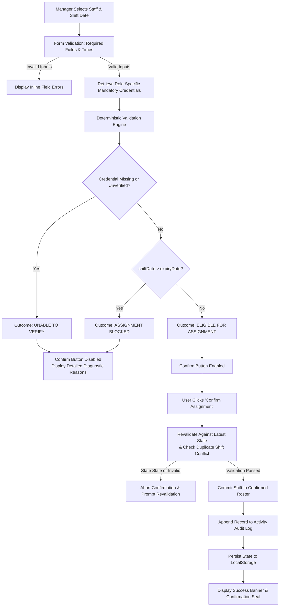

# Shiftwell CareVerify

> **Every shift. Verified before assignment.**

[](https://www.typescriptlang.org/)
[](https://react.dev/)
[](https://vitejs.dev/)
[](https://tailwindcss.com/)

**Shiftwell CareVerify** is an interactive B2B SaaS prototype designed for healthcare workforce scheduling. It embeds automated, deterministic credential-compliance guardrails directly into shift assignment and shift-swap workflows, ensuring that no healthcare worker can be assigned to a clinical shift unless all mandatory professional credentials (e.g., Basic Life Support certification, State Nursing Council registration) are verified and active for the specific shift date.

- **Live Interactive Prototype:** [https://shiftwell-careverify.ai.studio](https://shiftwell-careverify.ai.studio)
- **GitHub Repository:** [https://github.com/gptshivam595/clinical-staff-scheduling-compliance](https://github.com/gptshivam595/clinical-staff-scheduling-compliance)

---

## Table of Contents

- [Problem Statement & Case Study Context](#problem-statement--case-study-context)
- [Product Context & Prioritisation](#product-context--prioritisation)
- [Core Invariant](#core-invariant)
- [Application Features & Screen Walkthrough](#application-features--screen-walkthrough)
  - [1. Credential Overview (Dashboard)](#1-credential-overview-dashboard)
  - [2. Staff Profiles & Credential Management](#2-staff-profiles--credential-management)
  - [3. Assign Shift & Real-Time Eligibility Evaluation](#3-assign-shift--real-time-eligibility-evaluation)
  - [4. Confirmed Roster](#4-confirmed-roster)
  - [5. Shift-Swap Compliance Guardrail](#5-shift-swap-compliance-guardrail)
  - [6. Compliance Activity Log](#6-compliance-activity-log)
  - [7. Interactive Test Scenario Harness](#7-interactive-test-scenario-harness)
- [Credential Validation Rules](#credential-validation-rules)
- [Technical Architecture](#technical-architecture)
  - [Architecture Flowchart](#architecture-flowchart)
  - [Deterministic Validation Engine](#deterministic-validation-engine)
  - [State Management & Browser Persistence](#state-management--browser-persistence)
  - [Project Directory Structure](#project-directory-structure)
- [Installation & Local Development](#installation--local-development)
  - [Prerequisites](#prerequisites)
  - [Step-by-Step Setup](#step-by-step-setup)
  - [Available Scripts](#available-scripts)
  - [Environment Variables](#environment-variables)
- [Prototype Scope & Limitations](#prototype-scope--limitations)
- [Success Criteria & Proposed Metrics](#success-criteria--proposed-metrics)
- [Links, Credits & Disclosures](#links-credits--disclosures)

---

## Problem Statement & Case Study Context

In healthcare scheduling, shift managers often coordinate high-velocity rosters under immense operational pressure. In the case study context:

- **Customer:** CarePoint Clinics (a multi-location outpatient and specialty clinic network with 40 branches, 900 clinical staff, and ₹60 Lakh in annual recurring revenue).
- **The Issue:** CarePoint incurred **two documented regulatory audit findings** where Registered Nurses were rostered and worked shifts despite having expired Basic Life Support (BLS) certificates. A third finding could trigger financial penalties and suspension of clinical accreditation.
- **Root Cause:** Clinic managers were tracking certificate expiry dates manually in separate Excel spreadsheets. During daily roster creation and last-minute shift swaps, managers frequently forgot or lacked the time to cross-reference spreadsheets before confirming assignments.
- **The Solution:** **Shiftwell CareVerify** eliminates manual verification by making credential checks a programmatic prerequisite for scheduling. Rather than treating compliance as a periodic audit task, verification is enforced at the moment of assignment confirmation and shift swap.

---

## Product Context & Prioritisation

This prototype addresses the first and most critical milestone of the Shiftwell compliance roadmap:

1. **Why CarePoint Was Prioritised First:**
   - **Imminent Commercial Risk:** CarePoint's contract is up for renewal in December 2026. Two audit findings put the account at acute churn risk.
   - **Severe Regulatory Exposure:** In clinical care, expired life-support certificates represent immediate patient safety and legal liability.
   - **High ROI on Focused Scope:** An initial deterministic scheduling guardrail required an estimated one-sprint implementation, delivering immediate risk mitigation before broader workflow overhauls.

2. **Distinct Problem from Shift-Swap Approvals (e.g., FreshBowl):**
   - Other Shiftwell customers (such as FreshBowl in quick-service restaurants) suffered from operational bottlenecks like low manager swap-approval rates.
   - CarePoint's challenge was fundamentally different: **compliance enforcement, not operational velocity**.
   - The Shiftwell roadmap proposes addressing the hard clinical compliance guardrail first (CareVerify), while reusable, rules-based swap automations for operational speed represent a distinct, subsequent initiative. CareVerify does not claim to solve FreshBowl's approval rate problem.

---

## Core Invariant

The entire application enforces one non-negotiable operational invariant:

$$\textbf{No assignment or shift swap may be confirmed if any mandatory credential required for that role is missing, unverified, or invalid for the target shift date.}$$

Warnings alone are insufficient in clinical environments. When an invalid credential is detected, the confirmation action is **strictly disabled**.

---

## Application Features & Screen Walkthrough

### 1. Credential Overview (Dashboard)
- **Dynamic KPI Summary Cards:**
  - **Total Staff:** Number of clinical staff tracked in the system.
  - **Eligible Staff:** Employees whose mandatory role credentials are verified and valid as of the reference demo date (`19 Oct 2026`).
  - **Expired Credentials:** Total required credential records that have expired.
  - **Missing Records:** Mandatory documents missing from staff profiles.
  *(All KPI metrics are derived dynamically from active state—never hardcoded.)*
- **Staff Credential Table:** Real-time visibility into each staff member's BLS status, State Nursing Council registration, overall readiness badge, and next upcoming expiry date.
- **Search & Multi-Filter Controls:** Filter simultaneously by text (name, employee ID, role), clinical role, readiness status (*Eligible* vs. *Blocked*), and credential issue type (*Expired*, *Missing*, *Pending*).

### 2. Staff Profiles & Credential Management
- **Detailed Profile View:** Inspects staff member details (name, employee ID, role, clinical location, contact info) and mandatory role credential requirements.
- **Credential Metadata:** Displays credential title, accreditation body, license/registration number, issue date, valid-through expiry date, and audit trail notes.
- **Interactive "Update Credential" Modal:** Enables clinic managers or compliance officers to:
  - Update valid-through expiry dates.
  - Adjust verification statuses (*Verified*, *Pending*, *Failed*, *Missing*).
  - Update issue dates and compliance notes.
- **Instant Re-Evaluation:** Saving updates recalculates employee eligibility, updates overview summary counts, reflects in future assignment checks, and logs an entry in the Activity Log.

### 3. Assign Shift & Real-Time Eligibility Evaluation
- **Assignment Form:**
  - Staff selection (defaults to Ananya Sharma, `CP-001`).
  - Auto-displayed employee role and clinic branch.
  - Target shift date picker (defaults to `19 Oct 2026`).
  - Shift time selection with validation (enforces end time > start time).
  - Clinical station selection (e.g., *ICU / Critical Care*, *Emergency Ward*, *Outpatient*, *Pediatrics*).
- **Three Deterministic Outcomes:**
  - **Outcome A — Eligible for Assignment (Green):** All mandatory credentials verified and valid through shift date. The *"Confirm Assignment"* button is enabled.
  - **Outcome B — Assignment Blocked: Expired Credential (Red):** Identifies the exact expired credential, expiry date, and shift date. The *"Confirm Assignment"* button is **strictly disabled**.
  - **Outcome C — Unable to Verify Eligibility (Amber):** Triggered when a required credential is missing, pending review, or failed verification. Confirmation is **strictly disabled**.
- **Stale State Protection:** If a manager modifies the staff member, shift date, or time after running a check, the previous evaluation is marked stale and revalidation is required before confirmation.
- **Two-Phase Confirmation Check:** Clicking *"Confirm Assignment"* immediately re-evaluates the latest employee record to prevent race conditions or stale confirmations, checks for duplicate assignments on the same date/station, writes the shift to the roster, and logs the event.

### 4. Confirmed Roster
- Displays all authorized clinical shifts with employee name, role, station, clinic location, shift hours, and confirmation timestamp.
- **Compliance Seal:** Each rostered shift carries a *"CareVerify Confirmed"* badge.
- **Shift Details Modal:** Inspects the verified credentials snapshot captured at the exact moment of confirmation.

### 5. Shift-Swap Compliance Guardrail
- Extends compliance protection to peer-to-peer shift swaps.
- Managers select an existing confirmed shift and a proposed replacement staff member.
- Evaluates the replacement employee using the **exact same deterministic validation engine**.
- If the replacement employee possesses an expired, missing, or unverified credential, the swap is **blocked with detailed diagnostics**.
- Eligible swaps update the roster assignment, store a record of the original assignee, and log the action to the audit trail.

### 6. Compliance Activity Log
- Reverse chronological audit log tracking every key prototype event:
  - `ASSIGNMENT_CONFIRMED`
  - `ASSIGNMENT_BLOCKED`
  - `ELIGIBILITY_CHECK_PASSED` / `ELIGIBILITY_CHECK_BLOCKED`
  - `CREDENTIAL_UPDATED`
  - `SWAP_CONFIRMED` / `SWAP_BLOCKED`
  - `DATA_RESET`
- Includes employee ID, action timestamp, shift parameters, diagnostic reasons for failure, and outcome badges (*SUCCESS*, *BLOCKED*, *WARNING*, *INFO*). Filterable by outcome category.

### 7. Interactive Test Scenario Harness
- Built-in *"Scenarios"* modal accessible from the top navigation bar.
- Provides 1-click execution for all test cases specified in the Master Build Specification (Tests A through J):
  - **Test A:** Valid Assignment (Ananya Sharma — Eligible)
  - **Test B:** Expired Credential Block (Rohan Verma — BLS expired 10 Oct 2026)
  - **Test C:** Missing Record Block (Priya Das — Nursing Council missing)
  - **Test D-1:** Boundary Day Pass (Meera Singh — Shift on 20 Oct 2026, valid)
  - **Test D-2:** Boundary Day Block (Meera Singh — Shift on 21 Oct 2026, expired)
  - **Test E:** Pending Verification Block (Arjun Nair — BLS awaiting sign-off)
  - **Test F:** Shift Swap Guardrail Protection
- **Reset Demo Data Action:** Restores initial baseline records, credentials, roster, and activity events with a single click.

---

## Credential Validation Rules

The validation logic in `src/utils/validationEngine.ts` enforces these explicit rules:

1. **Role-Based Credential Mapping:**
   - **Registered Nurse:** Requires (1) Basic Life Support (BLS) Certification and (2) State Nursing Council Registration.
   - **General Physician:** Requires (1) Basic Life Support (BLS) Certification and (2) State Medical Council Registration.
2. **Missing Credential:** If a mandatory credential record does not exist or has status `MISSING`, the assignment is blocked (`UNABLE_TO_VERIFY`).
3. **Pending Verification:** If a credential is marked `PENDING`, it is blocked (`UNABLE_TO_VERIFY`) until compliance officers sign off.
4. **Failed Verification:** If a credential is marked `FAILED`, it is blocked (`UNABLE_TO_VERIFY`).
5. **Unknown Expiry:** If a mandatory credential requires an expiry date but none is recorded, it is blocked (`UNABLE_TO_VERIFY`).
6. **Expired Credential:** If the selected `shiftDate` is strictly greater than the credential's `expiryDate`, the assignment is blocked (`BLOCKED_EXPIRED`).
7. **Expiry Boundary Rule:** The expiry date is treated as the **final calendar day** the credential remains valid:
   - *Example:* BLS certificate expires on `20 Oct 2026`.
   - Shift on `20 Oct 2026` $\rightarrow$ **Valid / Eligible** (with an *Expiring Soon* informational warning if within 30 days).
   - Shift on `21 Oct 2026` $\rightarrow$ **Expired / Blocked**.
8. **Fixed Reference Demo Date:** Evaluated against an explicit demo reference date (`2026-10-19`) to prevent host machine timezone offsets or client clock skews from altering deterministic test outcomes.
9. **Multi-Failure Diagnostic Output:** If multiple credentials fail (e.g., one expired and one missing), all failure reasons are surfaced to the user.

---

## Technical Architecture

### Architecture Flowchart



### Deterministic Validation Engine
- **No LLM or Probabilistic Dependencies:** Credential decisions are calculated entirely via deterministic pure functions in TypeScript (`src/utils/validationEngine.ts`). No generative AI models or non-deterministic APIs are used for compliance decisions.
- **Pure Calendar Date Comparison:** Avoids `Date.getTime()` timezone shifts by parsing ISO strings (`YYYY-MM-DD`) into integer representations (`YYYYMMDD`) in `src/utils/dateUtils.ts`.

### State Management & Browser Persistence
- Centralized React Context (`src/context/AppContext.tsx`) managing:
  - Staff directory (`employees`)
  - Confirmed shifts (`assignments`)
  - Audit trail (`activities`)
  - Clinic location selection & demo reference date
  - Active view navigation & prefilled shift parameters
- State updates are automatically synchronized to browser `localStorage` using the prefix `shiftwell_careverify_`.
- A dedicated **Reset Demo Data** function purges local storage keys and restores the original baseline dataset.

### Project Directory Structure

```text
.
├── .env.example             # Optional environment variable placeholders
├── .gitignore
├── bun.lock                 # Bun lockfile
├── index.html               # App entry HTML with Shiftwell CareVerify metadata
├── metadata.json            # AI Studio applet metadata & capabilities
├── package.json             # Dependencies, scripts, and package config
├── tsconfig.json            # TypeScript compiler configuration
├── vite.config.ts           # Vite bundler configuration with Tailwind CSS plugin
└── src/
    ├── main.tsx             # React DOM root render
    ├── App.tsx              # Application layout shell, navigation, and view router
    ├── index.css            # Tailwind CSS v4 imports & custom design tokens
    ├── types.ts             # TypeScript interfaces for staff, credentials, shifts, and audits
    ├── context/
    │   └── AppContext.tsx   # Global state, persistence, validation actions, and scenario runner
    ├── data/
    │   └── initialData.ts   # Baseline fictional CarePoint Clinics staff & shift dataset
    ├── utils/
    │   ├── dateUtils.ts     # Timezone-safe calendar math, formatting, and boundary helpers
    │   └── validationEngine.ts # Deterministic credential compliance validation engine
    └── components/
        ├── Header.tsx       # Top bar with CarePoint label, location picker & ref date
        ├── Sidebar.tsx      # Brand identity, navigation links & active status badge
        ├── CredentialOverview.tsx # Screen 1: Dashboard KPI cards & staff directory table
        ├── StaffProfile.tsx       # Screen 2: Staff profile & credential update modal
        ├── AssignShift.tsx        # Screens 3 & 4: Assignment form & eligibility result view
        ├── RosterView.tsx         # Screen 5a: Confirmed shifts & verification seal details
        ├── ShiftSwapView.tsx      # Part 10: Shift-swap guardrail compliance workflow
        ├── ActivityLogView.tsx    # Screen 5b: Filterable compliance audit trail
        ├── AboutModal.tsx         # Prototype background, problem statement & disclosures
        ├── DemoScenariosModal.tsx # 1-click test scenario runner (Tests A through J)
        └── ToastContainer.tsx     # In-app feedback and alert notifications
```

---

## Installation & Local Development

### Prerequisites
- **Node.js:** v18.0.0 or higher
- **Package Manager:** `npm` (v9+) or `bun` (v1.0+)

### Step-by-Step Setup

1. **Clone the repository:**
   ```bash
   git clone https://github.com/gptshivam595/clinical-staff-scheduling-compliance.git
   cd clinical-staff-scheduling-compliance
   ```

2. **Install dependencies:**
   Using `npm`:
   ```bash
   npm install
   ```
   Or using `bun`:
   ```bash
   bun install
   ```

3. **Start the local development server:**
   ```bash
   npm run dev
   ```
   The local development server runs on `http://localhost:3000` (or `http://0.0.0.0:3000`).

4. **Open in browser:**
   Navigate to [http://localhost:3000](http://localhost:3000) to interact with the prototype.

### Available Scripts

These scripts are defined in `package.json`:

| Command | Action |
| :--- | :--- |
| `npm run dev` | Starts the Vite development server on port 3000 (`vite --port=3000 --host=0.0.0.0`) |
| `npm run build` | Compiles TypeScript and builds production assets into `dist/` (`vite build`) |
| `npm run preview` | Previews the production build locally (`vite preview`) |
| `npm run lint` | Runs TypeScript type checking without emitting files (`tsc --noEmit`) |
| `npm run clean` | Removes build output directories (`rm -rf dist server.js`) |

*(Note: There is no separate automated test runner script such as Jest or Vitest in `package.json`. Comprehensive functional testing is provided via the in-app interactive scenario harness and strict TypeScript type checking.)*

### Environment Variables

**No environment variables or API keys are required to run this prototype.**

All credential verification logic, sample clinical staff records, and scheduling workflows execute client-side in the browser. 

The repository includes a `.env.example` file referencing `GEMINI_API_KEY` and `APP_URL`, which are standard boilerplate placeholders for optional AI Studio platform deployment integrations, but they are not used by the core CareVerify credential-validation engine.

---

## Prototype Scope & Limitations

This repository contains a **functional product design prototype** developed for evaluation, demonstration, and technical interviews. Please note the following scope boundaries:

- **Simulated Credential Registry:** Credential checks are evaluated deterministically against internal records. The application does not connect to live statutory registries (e.g., Karnataka State Nursing Council, Indian Resuscitation Council Federation, American Heart Association, or National Medical Commission).
- **Fictional Demonstration Data:** All staff names, employee IDs, clinic branches, certificate numbers, and audit findings are entirely fictional.
- **Client-Side Persistence:** Application state is stored in browser `localStorage`. It is not a tamper-proof or regulatory-grade clinical audit database.
- **No External System Integrations:** The prototype does not integrate with live electronic health records (EHR/HIS), payroll systems, workforce forecasting tools, or messaging platforms (e.g., WhatsApp).
- **No Regulatory Certification:** The prototype demonstrates a product concept and UX architecture; it does not constitute clinical certification or guarantee statutory compliance.

### Planned Production Roadmap
The following items represent necessary future engineering requirements for a production deployment:
1. **Primary Source Verification (PSV):** Direct API integrations with national and state credential issuing authorities.
2. **Role-Based Access Control (RBAC):** Distinct permission tiers for Clinic Managers, Compliance Officers, Medical Directors, and Staff Nurses.
3. **Immutable Audit Logging:** Server-authoritative, tamper-evident audit logging stored in an append-only relational database.
4. **Automated Document OCR & Expiry Ingestion:** Automated extraction of expiry dates and certificate IDs from uploaded document images.
5. **Automated Unit & Integration Test Suite:** Comprehensive Vitest / Playwright test suites integrated into CI/CD pipelines.

---

## Success Criteria & Proposed Metrics

### Proposed Functional Acceptance Criteria (Prototype Verification Targets)
- **Zero Confirmed Invalid Assignments:** 100% of confirmed shifts on the roster must have verified, active mandatory credentials for the target shift date.
- **Deterministic Blocking:** Any expired, missing, pending, or failed credential must prevent assignment confirmation.
- **Consistent Expiry Boundary Behavior:** Shifts scheduled on the exact day of credential expiry must be permitted; shifts scheduled the day after expiry must be blocked.
- **Pre-Commit Revalidation:** Shift parameters are re-verified immediately upon clicking confirmation, eliminating stale state bypasses.

### Suggested Production Metrics (Future Evaluation)
When deploying a credential-verification capability in production, success should be evaluated using:
- **Blocked Scheduling Attempts:** Number of times the guardrail actively intercepted an assignment attempt with an invalid credential.
- **Staff Credential Completeness Rate:** Percentage of rostered staff with active, verified credentials uploaded prior to roster publication.
- **Manager Compliance Override Rate:** Frequency and justification of emergency managerial compliance overrides (target: 0% unlogged overrides).
- **Audit Findings:** Number of external or internal audit findings related to staff credential non-compliance (target: 0).

---

## Links, Credits & Disclosures

- **Interactive Prototype:** [https://shiftwell-careverify.ai.studio](https://shiftwell-careverify.ai.studio)
- **GitHub Repository:** [https://github.com/gptshivam595/clinical-staff-scheduling-compliance](https://github.com/gptshivam595/clinical-staff-scheduling-compliance)

### AI-Use Disclosure
- **ChatGPT (OpenAI):** Utilized for initial case study analysis, problem structuring, prioritisation frameworks, and technical documentation drafting.
- **Google AI Studio:** Utilized as the development and preview platform to scaffold and host the interactive prototype.
- **Deterministic Logic:** All credential-validation rules, calendar date boundary calculations, and scheduling eligibility decisions are implemented using explicit, deterministic TypeScript code and do not rely on generative AI or LLMs.

### License
No formal open-source license has been specified for this repository. All rights reserved.
